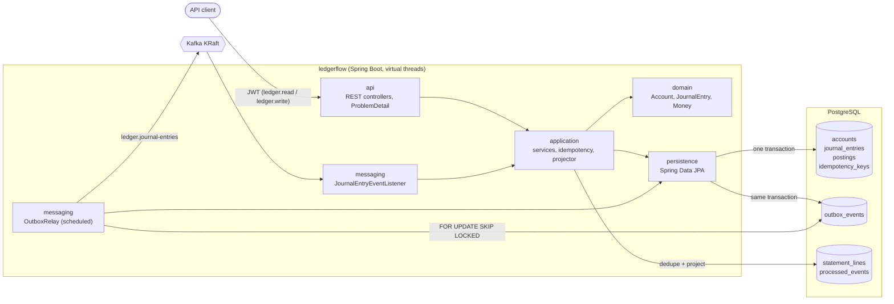
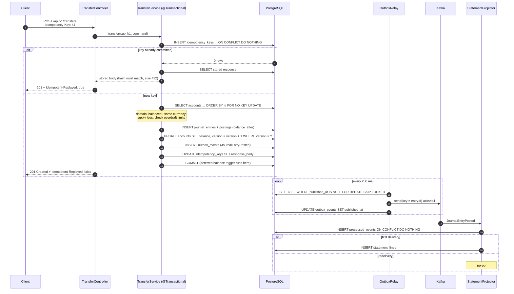

# ledgerflow

[](https://github.com/RatulSikder97/ledgerflow/actions/workflows/ci.yml)


An event-driven **double-entry ledger service** built with Spring Boot 3, Java 21, PostgreSQL and Kafka.

It is a compact but production-shaped reference for the parts of a money-moving system that are easy to get
subtly wrong: balanced, immutable journal entries; integer minor-unit money; no lost updates under concurrency;
idempotent writes; and reliable event publication through a transactional outbox into an exactly-once-effect
read model.

| Concern | How ledgerflow handles it |
|---|---|
| Correctness of the books | Debits == credits **per currency**, enforced in the domain model *and* by a deferred PostgreSQL constraint trigger |
| Auditability | Entries and postings are append-only (DB triggers reject `UPDATE`/`DELETE`); corrections are **reversal** entries; each posting stores `balance_after` |
| Money representation | `long` minor units + ISO 4217 currency; overflow-checked arithmetic; no `double`/`float` anywhere |
| Concurrency | Row locks (`SELECT … FOR NO KEY UPDATE`) in a global id order + `@Version` optimistic locking as a second guard |
| Retries | `Idempotency-Key` header, stored with a SHA-256 request hash and the response, committed atomically with the transfer |
| Events | Transactional outbox → Kafka relay using `FOR UPDATE SKIP LOCKED`; idempotent producer, `acks=all` |
| Read model | Kafka consumer projects account statements; a `processed_events` table gives exactly-once *effect* |
| Platform | Flyway, Spring Data JPA, Bean Validation, RFC 9457 `ProblemDetail`, OAuth2 resource server (JWT scopes), virtual threads, Actuator + Prometheus, OpenAPI |
| Tests | JUnit 5 + AssertJ unit tests, Testcontainers (Postgres + Kafka KRaft) integration tests, ArchUnit layering rules |

## Architecture



Layering (`api → application → persistence/domain`, `messaging → application`) is enforced by
[`ArchitectureTest`](src/test/java/dev/ledgerflow/architecture/ArchitectureTest.java): controllers never touch
repositories, `@Transactional` lives only in the application/messaging layers, the domain is free of Spring
stereotypes, and package slices are cycle-free.

### A transfer, end to end



## Quickstart

Requirements: Docker, `curl`, `jq`, `openssl`.

```bash
docker compose up -d --build
until curl -sf localhost:8080/actuator/health/readiness > /dev/null; do sleep 2; done

TOKEN=$(scripts/dev-token.sh "ledger.read ledger.write")
AUTH="Authorization: Bearer $TOKEN"
JSON="Content-Type: application/json"
```

`scripts/dev-token.sh` mints a short-lived HS256 token signed with the local demo key configured in
`docker-compose.yml`. In a real deployment you unset that key and point
`spring.security.oauth2.resourceserver.jwt.issuer-uri` at your identity provider.

**Open accounts.** A settlement account (an ASSET: money the operator holds) and two customer wallets
(LIABILITIES: money owed to customers).

```bash
open_account() {
  curl -s -X POST localhost:8080/api/v1/accounts -H "$AUTH" -H "$JSON" \
    -d "{\"code\":\"$1\",\"name\":\"$2\",\"type\":\"$3\",\"currency\":\"USD\"}" | jq -r .id
}
BANK=$(open_account settlement-usd "Settlement USD" ASSET)
ALICE=$(open_account wallet-alice "Alice" LIABILITY)
BOB=$(open_account wallet-bob "Bob" LIABILITY)
```

**Deposit 100.00 USD to Alice** (amounts are integers in minor units: `10000` = 100.00 USD).

```bash
curl -s -X POST localhost:8080/api/v1/transfers -H "$AUTH" -H "$JSON" \
  -H "Idempotency-Key: deposit-alice-0001" \
  -d "{\"sourceAccountId\":\"$BANK\",\"destinationAccountId\":\"$ALICE\",\"amountMinor\":10000,\"currency\":\"USD\",\"description\":\"card top-up\"}" | jq
```

**Alice pays Bob 25.50 USD, then the client retries** with the same key. The second call returns the stored
response with `Idempotent-Replayed: true`; money moves once.

```bash
PAY="{\"sourceAccountId\":\"$ALICE\",\"destinationAccountId\":\"$BOB\",\"amountMinor\":2550,\"currency\":\"USD\",\"description\":\"lunch\"}"
curl -s -D - -o /dev/null -X POST localhost:8080/api/v1/transfers -H "$AUTH" -H "$JSON" -H "Idempotency-Key: pay-bob-0001" -d "$PAY" | grep -i idempotent-replayed
curl -s -D - -o /dev/null -X POST localhost:8080/api/v1/transfers -H "$AUTH" -H "$JSON" -H "Idempotency-Key: pay-bob-0001" -d "$PAY" | grep -i idempotent-replayed

curl -s localhost:8080/api/v1/accounts/$ALICE -H "$AUTH" | jq .balance
# { "amountMinor": 7450, "currency": "USD", "amount": "74.50" }
```

**Rules are enforced with problem details.** Overdrawing a wallet:

```bash
curl -s -X POST localhost:8080/api/v1/transfers -H "$AUTH" -H "$JSON" -H "Idempotency-Key: overdraft-0001" \
  -d "{\"sourceAccountId\":\"$BOB\",\"destinationAccountId\":\"$ALICE\",\"amountMinor\":999999,\"currency\":\"USD\"}" | jq
# { "type": "urn:ledgerflow:problem:insufficient-funds", "status": 422, "retryable": false, ... }
```

**Read Bob's statement** from the Kafka-built projection (eventually consistent, typically < 1 s behind):

```bash
sleep 2   # right after startup the consumer may still be joining its group
curl -s "localhost:8080/api/v1/accounts/$BOB/statement?size=10" -H "$AUTH" \
  | jq '.content[] | {entryType, direction, amount: .amount.amount, balanceAfter: .balanceAfter.amount}'
```

**Reverse the payment.** Entries are immutable, so the only way to undo one is to post its mirror image.
A second reversal of the same entry is rejected with `409`.

```bash
ENTRY=$(curl -s -X POST localhost:8080/api/v1/transfers -H "$AUTH" -H "$JSON" -H "Idempotency-Key: pay-bob-0001" -d "$PAY" | jq -r .id)
curl -s -X POST localhost:8080/api/v1/journal-entries/$ENTRY/reversal -H "$AUTH" -H "$JSON" \
  -d '{"reason":"sent by mistake"}' | jq '{type, reversesEntryId, postings: [.postings[] | {direction, amount: .amount.amount}]}'
```

**Multi-leg, multi-currency entries.** Converting 10.00 USD to 9.20 EUR through FX position accounts: every
currency group balances on its own.

```bash
EUR_WALLET=$(curl -s -X POST localhost:8080/api/v1/accounts -H "$AUTH" -H "$JSON" \
  -d '{"code":"wallet-alice-eur","name":"Alice EUR","type":"LIABILITY","currency":"EUR"}' | jq -r .id)
FX_USD=$(curl -s -X POST localhost:8080/api/v1/accounts -H "$AUTH" -H "$JSON" \
  -d '{"code":"fx-position-usd","name":"FX position USD","type":"EQUITY","currency":"USD","allowNegative":true}' | jq -r .id)
FX_EUR=$(curl -s -X POST localhost:8080/api/v1/accounts -H "$AUTH" -H "$JSON" \
  -d '{"code":"fx-position-eur","name":"FX position EUR","type":"EQUITY","currency":"EUR","allowNegative":true}' | jq -r .id)

curl -s -X POST localhost:8080/api/v1/journal-entries -H "$AUTH" -H "$JSON" -H "Idempotency-Key: fx-alice-0001" -d "{
  \"description\": \"FX USD->EUR @ 0.92\",
  \"postings\": [
    {\"accountId\":\"$ALICE\",     \"direction\":\"DEBIT\",  \"amountMinor\":1000, \"currency\":\"USD\"},
    {\"accountId\":\"$FX_USD\",    \"direction\":\"CREDIT\", \"amountMinor\":1000, \"currency\":\"USD\"},
    {\"accountId\":\"$FX_EUR\",    \"direction\":\"DEBIT\",  \"amountMinor\":920,  \"currency\":\"EUR\"},
    {\"accountId\":\"$EUR_WALLET\",\"direction\":\"CREDIT\", \"amountMinor\":920,  \"currency\":\"EUR\"}
  ]}" | jq '.postings[] | {direction, amount: .amount, balanceAfter: .balanceAfter.amount}'
```

**Observe it.**

```bash
curl -s localhost:8080/actuator/prometheus | grep -E '^ledgerflow_'
open http://localhost:8080/swagger-ui.html   # OpenAPI UI; use "Authorize" with $TOKEN
```

Reset everything with `docker compose down -v`.

### Running locally without Docker Compose

```bash
./mvnw spring-boot:test-run      # starts Postgres + Kafka via Testcontainers, then the app on :8080
./mvnw verify                    # unit tests, ArchUnit, Testcontainers integration tests
```

`spring-boot:test-run` does not set the dev signing key; export
`LEDGERFLOW_SECURITY_DEVJWTSECRET=local-dev-only-signing-key-change-me-0123456789` first if you want to use
`scripts/dev-token.sh` against it.

## API

| Method | Path | Scope | Notes |
|---|---|---|---|
| `POST` | `/api/v1/accounts` | `ledger.write` | `type`: ASSET, LIABILITY, EQUITY, REVENUE, EXPENSE |
| `GET` | `/api/v1/accounts/{id}` | `ledger.read` | Strongly consistent balance from the write model |
| `GET` | `/api/v1/accounts/{id}/statement` | `ledger.read` | Projection, newest first, paged |
| `POST` | `/api/v1/transfers` | `ledger.write` | Requires `Idempotency-Key` |
| `POST` | `/api/v1/journal-entries` | `ledger.write` | Multi-leg / multi-currency; requires `Idempotency-Key` |
| `GET` | `/api/v1/journal-entries/{id}` | `ledger.read` | Entry with postings and `balanceAfter` |
| `POST` | `/api/v1/journal-entries/{id}/reversal` | `ledger.write` | At most once per entry |

Errors are `application/problem+json` with a stable `type` (`urn:ledgerflow:problem:<slug>`) and a `retryable`
flag: `insufficient-funds`, `unbalanced-entry`, `currency-mismatch`, `idempotency-key-reuse`,
`entry-already-reversed`, `account-not-found`, `validation-failed`, `concurrent-modification`, …

## Design decisions

### Why minor units in a `long`

Binary floating point cannot represent `0.10`, and rounding errors in a ledger are compounding, silent and
auditable. Every amount is an integer count of the currency's minor unit (cents, yen, fils) paired with its
ISO 4217 code, and all arithmetic goes through `Math.addExact`/`subtractExact`, so overflow throws instead of
wrapping. `BigDecimal` is used only to *render* the display string, using the currency's own number of
fraction digits (`JPY` has 0, `KWD` has 3). A signed 64-bit integer holds ±92 quadrillion minor units, which
is far beyond any realistic single balance.

### Why double entry, immutability and reversals

Each journal entry is a set of postings whose debits equal credits per currency, so the books balance by
construction and value is never created or destroyed by a bug in one code path. The rule is checked twice: in
`JournalEntry` (fast feedback, clear 422s) and by a `DEFERRABLE INITIALLY DEFERRED` constraint trigger that
runs at commit, catching any write path that bypasses the domain. Entries and postings are append-only;
`UPDATE`/`DELETE` are rejected by triggers. A correction is a new `REVERSAL` entry linked by a unique
`reverses_entry_id`, which also makes reversals naturally idempotent. Every posting stores the balance after
it was applied, so a statement line is self-describing.

Account balances are stored on the account's *normal side* (debits increase ASSET/EXPENSE, credits increase
LIABILITY/EQUITY/REVENUE). A customer wallet is a liability, which is why a transfer *debits* the payer's
wallet and *credits* the payee's.

### Concurrency: pessimistic where it matters, optimistic as a guard

A transfer locks all involved account rows with one `SELECT … ORDER BY id FOR NO KEY UPDATE`. Locking in a
global order means two opposite transfers between the same accounts queue up instead of deadlocking, and
`NO KEY UPDATE` does not block inserts of postings that reference the account. Overdraft checks therefore
see the latest committed balance. Accounts also carry a JPA `@Version`, so any write path that forgets the
lock (or holds a stale copy) fails with `409 concurrent-modification` instead of silently overwriting. Hot
accounts serialise; that is the price of a strongly consistent balance, and the lock is held only for the
short write transaction.

`TransferConcurrencyIT` fires 400 random transfers between five wallets from virtual threads and asserts that
no balance is negative, that each cached balance equals the sum of its postings, that the total is conserved,
and that each account's version advanced exactly once per posting. A second test proves a stale write is
rejected by the version check.

### Idempotency

`Idempotency-Key` is required on `POST /transfers` and `POST /journal-entries` and scoped per client (the
JWT `sub`). The key is claimed with `INSERT … ON CONFLICT DO NOTHING` **in the same transaction** as the
transfer, together with a SHA-256 hash of the operation and request body; the serialised response is stored
before commit. Consequences:

* A retry after success replays the stored response (`Idempotent-Replayed: true`).
* The same key with a different body is rejected (`422 idempotency-key-reuse`).
* A concurrent duplicate blocks on the key's unique index until the first request finishes, then replays.
* A failed request (e.g. insufficient funds) rolls back the key too, so the client may retry it safely.

Keys are kept indefinitely here; production systems usually expire them after 24 hours to a few days.

### Why a transactional outbox

Writing to PostgreSQL and publishing to Kafka are two separate systems with no shared transaction. Publishing
after commit loses events on a crash; publishing before commit announces entries that may roll back. Instead,
`LedgerPoster` inserts the `JournalEntryPosted` event into `outbox_events` in the same transaction as the
entry, so the event exists if and only if the entry does. `OutboxRelay` drains it:

* `SELECT … FOR UPDATE SKIP LOCKED` lets multiple instances relay in parallel without double-sending or
  blocking each other.
* Records are keyed by entry id; the producer is idempotent with `acks=all`, and the send is awaited before
  the row is marked published.
* A crash between send and commit re-sends the event, so delivery is **at least once**.

Published rows are retained as an audit trail; a scheduled purge or partition drop is the usual production
addition.

### Consistency model

| Data | Consistency |
|---|---|
| Account balance (`GET /accounts/{id}`), journal entries | Strong: read from the write model after commit |
| Account statement (`GET /accounts/{id}/statement`) | Eventual: Kafka projection, typically sub-second lag (`ledgerflow_outbox_pending` shows the backlog) |
| Events | At-least-once delivery, exactly-once effect |

`StatementProjector` inserts `(consumer, event_id)` into `processed_events` with `ON CONFLICT DO NOTHING` in
the same transaction as the statement lines, and the offset is committed only after that transaction. A
redelivered event finds its marker and becomes a no-op; `OutboxProjectionIT` publishes a duplicate on purpose
and asserts nothing changes. Poison messages are retried with backoff and then parked on
`ledger.journal-entries.DLT`.

## Observability

* `GET /actuator/health/{liveness,readiness}` for orchestrator probes.
* `GET /actuator/prometheus`, including `http_server_requests_seconds` histograms and:
  `ledgerflow_entries_posted_total{type}`, `ledgerflow_idempotency_replays_total`,
  `ledgerflow_outbox_published_total`, `ledgerflow_outbox_publish_failures_total`, `ledgerflow_outbox_pending`,
  `ledgerflow_projection_events_total{result="applied|duplicate"}`.

## Project layout

```
src/main/java/dev/ledgerflow
├── api           REST controllers, request records, ProblemDetail mapping
├── application   transactional services: transfers, entries, idempotency, statement projector
├── domain        Account, JournalEntry, Posting, Money, events; no Spring beans
├── persistence   Spring Data repositories, outbox / idempotency / read-model entities
├── messaging     outbox relay and Kafka listener
└── config        security, Kafka topics + DLT, OpenAPI, properties
src/main/resources/db/migration   Flyway: schema, balance + immutability triggers
```

## License

[MIT](LICENSE)
